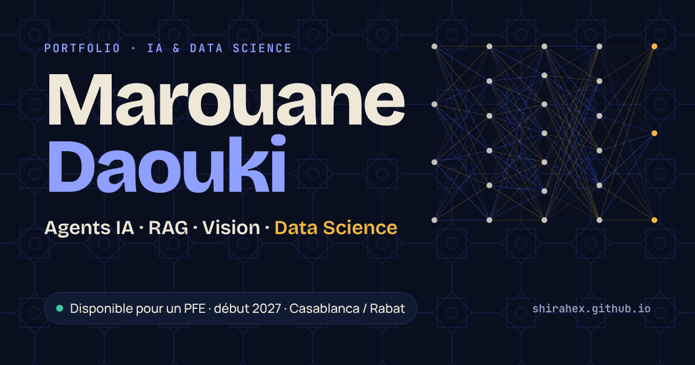

# Marouane Daouki · Portfolio

Interactive portfolio of **Marouane Daouki**, Master of Excellence in Artificial Intelligence student at Hassan II University, Casablanca.

**Live site: https://shirahex.github.io/marouane-daouki-portfolio/**

## What is inside

- Seven projects with real screenshots: AgentForge (multi-agent credit audit), Qannouni (RAG legal assistant), Carton Compliance Analyzer (YOLOv8 + OpenCV), PipelineForge (data pipeline + RAG), molecular property prediction (GNN vs Transformer), a Moroccan car price predictor and a cloud DevOps lab.
- Small in-browser demos: a simplified multi-agent credit audit, a sourced legal Q&A example, an animated data pipeline and a rotating molecule.
- A gradient descent golf mini game, a terminal (press the ` key) and a French / English switch.

Plain HTML, CSS and JavaScript in a single page, served by GitHub Pages.

## Contact

daoukimarouane@gmail.com · [LinkedIn](https://www.linkedin.com/in/daouki-marouane/) · [GitHub](https://github.com/shirahex)
